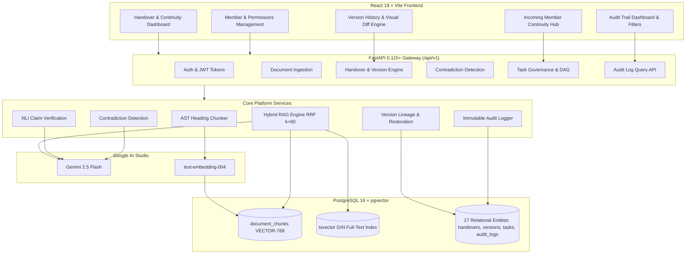

# CloudFrontier — AI-Powered Knowledge Handover & Engineering Continuity Platform

[](https://fastapi.tiangolo.com)
[](https://github.com/pgvector/pgvector)
[](https://ai.google.dev/)
[](https://react.dev)
[](https://vitejs.dev)
[](https://tailwindcss.com)
[]()

CloudFrontier is an enterprise-grade, production-ready knowledge transfer and developer continuity platform designed to eliminate the engineering productivity cliff when key developers depart or transition between teams.

By combining multi-format document ingestion (PDF, DOCX, TXT, Markdown) with dense pgvector semantic embeddings (`text-embedding-004` / `gemini-embedding-2`), PostgreSQL Full-Text Search (`tsvector`), and Google Gemini 2.5 generative models, CloudFrontier automatically extracts architecture, workflows, credentials, runbooks, and technical debt items into verified, structured, 10-chapter transition documentation.

---

## Table of Contents
1. [Project Overview](#project-overview)
2. [Technology Stack](#technology-stack)
3. [System Architecture](#system-architecture)
4. [Features Implemented](#features-implemented)
5. [Database Setup & Migrations](#database-setup--migrations)
6. [Gemini AI Configuration](#gemini-ai-configuration)
7. [Environment Variable Setup](#environment-variable-setup)
8. [Installation & Launch Guide](#installation--launch-guide)
9. [API Documentation](#api-documentation)
10. [Testing & Quality Assurance](#testing--quality-assurance)
11. [Known Limitations](#known-limitations)

---

## Project Overview

Engineering turnover and project reassignments traditionally result in severe knowledge leakage, broken onboarding cycles, and unmaintained legacy systems. Typical handovers consist of hurried meetings, obsolete READMEs, and unverified assumptions.

CloudFrontier solves this by providing:
- **Autonomous Knowledge Extraction**: Ingests codebases, runbooks, RFCs, and meeting notes to synthesize structured 10-chapter handovers.
- **Evidence Verification**: Backs every assertion with verifiable source citations and confidence scores using zero-temperature Natural Language Inference (NLI).
- **Cross-Document Contradiction Detection**: Flags conflicting statements, competing dates, and diverging architectural claims across documents for human lead arbitration.
- **Granular Role-Based Access Control (RBAC)**: Enforces role boundaries across 5 specialized project roles and 12 distinct permissions.
- **Immutable Audit Trail**: Records an append-only log of every permission change, handover revision, conflict resolution, and task status update.
- **Version Management & Safe Restoration**: Preserves full historical snapshots (`v1.0`, `v1.1`, etc.) and supports non-destructive restoration that always creates forward revisions (`v1.2`).
- **Incoming-Member Continuity Workflow**: Empowers new engineers with an assigned dashboard, formal receipt acknowledgement, DAG-based continuation task tracking, and milestone progress logging.

---

## Technology Stack

### Backend
- **Framework**: FastAPI 0.115+ (Python 3.11 / 3.12 / 3.15)
- **Database ORM**: SQLAlchemy 2.0 Async ORM with `asyncpg` driver
- **Migrations**: Alembic 1.13+ (10 sequential, unbroken migration revisions)
- **Database**: PostgreSQL 16 with `pgvector` extension (768-dimensional dense vector embeddings)
- **Search Engine**: PostgreSQL Full-Text Search (`pg_catalog.english` tsvector + GIN indexes)
- **Authentication**: Argon2id password hashing + JWT (JSON Web Tokens) with refresh token rotation
- **Document Parsers**: PyMuPDF (`fitz`), `python-docx`, Markdown parser, AST semantic chunker
- **PDF Engine**: ReportLab 4.x with two-pass `NumberedCanvas`

### AI & Machine Learning
- **SDK**: Google GenAI SDK (`google-genai` / `google-generativeai`)
- **Generative Models**: `gemini-2.5-flash` (low-latency generation, section editing, and verification) / `gemini-2.5-pro` (complex reasoning)
- **Embedding Models**: `text-embedding-004` / `gemini-embedding-2` (768-dimensional embeddings)
- **Retrieval Strategy**: Reciprocal Rank Fusion (RRF with parameter $k=60$) combining dense cosine similarity (`<=>`) and sparse BM25/FTS

### Frontend
- **Framework**: React 19 + TypeScript 5.7+
- **Build Tool**: Vite 6.1+
- **Styling**: Tailwind CSS 3.4 + `@tailwindcss/typography`
- **Routing**: React Router 7 (declarative nested routes)
- **State & UI**: Lucide React icons, Framer Motion animations, Context API (Auth, Theme, Toast, Role)

---

## System Architecture



---

## Features Implemented

### Improvement 1 — Evidence Verification & Contradiction Detection
- **Section-by-Section Verification**: Every claim generated in a handover chapter is isolated, cross-referenced with ingested document chunks, and scored for factual support (`Supported`, `Partially Supported`, `Unsupported`, `Conflicting`, `Insufficient Evidence`).
- **Database Persistence**: Stores evidence links in `evidence_references` and claim verifications in `handover_claims`, recording chunk offsets, document IDs, quotes, and reasoning.
- **Automated Contradiction Detection**: Scans multi-document corpuses for mutually exclusive claims across 5 categories: `Architecture & Infrastructure`, `Deployment & CI/CD`, `Access & Credentials`, `Timelines & Milestones`, and `Team Ownership`.
- **Conflict Arbitration Interface**: Project Leads and Owners can view side-by-side conflicting excerpts with document citations, choose authoritative sources, input overrides, and record arbitration notes.
- **Audit Integration**: Every conflict resolution triggers an immutable `CONFLICT_RESOLVED` event in the project audit log.

### Improvement 2 — Role-Based Access Control (RBAC) & Audit Trail
- **5 Granular Project Roles**:
  - `PROJECT_OWNER`: Full project administration, role assignment, deletion, and member revocation.
  - `LEAD`: Technical architecture oversight, handover approval, and conflict arbitration.
  - `REVIEWER`: Handover inspection, revision feedback, and approval sign-off.
  - `OUTGOING`: Handover generation, chapter synthesis, and revision editing.
  - `INCOMING`: Project continuity, receipt acknowledgement, and task progress execution.
- **12 Fine-Grained Permissions**:
  `VIEW_PROJECT`, `EDIT_PROJECT`, `DELETE_PROJECT`, `MANAGE_MEMBERS`, `VIEW_AUDIT_LOGS`, `UPLOAD_DOCUMENTS`, `DELETE_DOCUMENTS`, `GENERATE_HANDOVER`, `EDIT_HANDOVER`, `APPROVE_HANDOVER`, `SHARE_HANDOVER`, `MANAGE_TASKS`.
- **Member Management**:
  Invite new members by email, update roles with immediate permission propagation, and revoke membership with automatic session invalidation.
- **Immutable Audit Trail (`AuditLog`)**:
  - Tracks 16 distinct event actions with UTC timestamps, actor user ID, client IP address, HTTP method, and structured JSON change metadata.
  - Enforces database-level immutability (rejection of client-initiated UPDATE and DELETE operations).
  - Multi-criteria audit dashboard with filters by user, action type, date range, and pagination.

### Improvement 3 — Versioned Handovers & Incoming-Member Continuity
- **Immutable Historical Snapshots (`HandoverVersion`)**:
  - Every time a handover is generated, approved, or revised, a complete frozen JSON snapshot is stored.
  - Lineage tracking with `parent_version_id`, separate approval statuses (`DRAFT`, `IN_REVIEW`, `APPROVED`), and `is_latest` identification.
- **Non-Destructive Version Restoration**:
  - Restoring an earlier version (e.g. `v1.0`) creates a brand-new forward revision (`v1.2`) based on the selected snapshot.
  - Historical records (`v1.0`, `v1.1`) are never overwritten or deleted during restoration.
- **Version Comparison Engine**:
  - Computes structured section-by-section diffs (Project Overview, Architecture, Key Decisions, Pending Tasks, Risks, Dependencies, Responsibilities, Recommendations).
  - Identifies added, removed, and modified content lines, status changes, and reassigned responsibilities.
- **Incoming Member Continuity Hub**:
  - Dashboard displaying shared projects, received handovers, assigned tasks, unresolved blockers, and project dependencies.
  - **Formal Receipt Acknowledgement**: Distinct transition status flow (`Awaiting Acknowledgement` $\rightarrow$ `Acknowledged` $\rightarrow$ `In Progress` $\rightarrow$ `Completed`) separate from formal review approval.
  - **Task Governance & Status Tracking**: 4 task states (`Not Started`, `In Progress`, `Blocked`, `Completed`) with automatic handover transition status advancement.
  - **Timestamped Progress Logging**: Structured progress updates appended with author identity, timestamp, and status history.

---

## Database Setup & Migrations

CloudFrontier requires PostgreSQL 16 with the `pgvector` extension.

### 1. PostgreSQL & pgvector Setup
Connect to PostgreSQL and create the database:
```sql
CREATE DATABASE knowledge_handover;
\c knowledge_handover;
CREATE EXTENSION IF NOT EXISTS vector;
```

Verify extension installation:
```sql
SELECT extname, extversion FROM pg_extension WHERE extname = 'vector';
```

### 2. Alembic Migrations
The database schema is managed via 10 sequential Alembic revisions:
1. `001_initial_schema`: Users, projects, documents, handovers, sections, tasks.
2. `002_add_vector_index`: HNSW index on `document_chunks.embedding` (`vector_cosine_ops`).
3. `003_add_fts_index`: GIN full-text search indexes on documents and chunks.
4. `004_advanced_evidence_verification`: `evidence_references` and `handover_claims`.
5. `005_advanced_contradiction_detection`: `conflicts` and detection columns.
6. `006_granular_rbac`: Project member roles and permissions.
7. `007_project_member_management`: Member invitation status and role history.
8. `008_audit_trail_system`: `audit_logs` table and indexes.
9. `009_handover_version_management`: `handover_versions` snapshots and lineage.
10. `010_incoming_continuity_workflow`: Handover continuity columns and `task_progress_updates`.

Execute migrations using the verification runner:
```bash
python backend/scripts/run_migrations.py
```
Or directly via Alembic:
```bash
cd backend
alembic upgrade head
```

### 3. Verified Database Tables (17 Tables)
| Table | Description |
| :--- | :--- |
| `users` | User credentials, profiles, and global roles |
| `refresh_tokens` | SHA-256 hashed rotation refresh tokens |
| `projects` | Project workspaces and metadata |
| `project_members` | Role memberships and custom permissions |
| `documents` | Ingested source files and processing status |
| `document_chunks` | AST semantic text chunks with `VECTOR(768)` embeddings |
| `handovers` | Handover documents, status, continuity metadata |
| `handover_sections` | 10 synthesized chapters, content, confidence scores |
| `handover_versions` | Immutable historical snapshots and lineage |
| `handover_audit_logs` | Handover-specific transition history |
| `evidence_references` | Source citations and excerpt mappings |
| `conflicts` | Cross-document contradictions and arbitration records |
| `tasks` | Handover transition tasks and priorities |
| `task_dependencies` | Directed Acyclic Graph (DAG) task prerequisites |
| `task_progress_updates`| Structured progress notes with timestamps |
| `notifications` | In-app alerts for reviews, handovers, and tasks |
| `audit_logs` | Immutable enterprise audit trail |

---

## Gemini AI Configuration

CloudFrontier interfaces with Google Gemini using the official Google GenAI SDK.

### 1. Obtaining an API Key
Generate an API key in [Google AI Studio](https://aistudio.google.com/api-keys).

### 2. Configuration Parameters
In `backend/.env`:
```ini
GEMINI_API_KEY=AIzaSy...Your_Key_Here
GEMINI_MODEL=gemini-2.5-flash
GEMINI_EMBEDDING_MODEL=text-embedding-004
EMBEDDING_DIMENSION=768
```

### 3. AI Service Architecture
- **Embedding Generation**: Chunks are embedded in batches of 100 using `text-embedding-004` (768 dimensions), normalized for cosine distance retrieval.
- **Chapter Synthesis**: Handover chapters are generated with contextual prompts containing project-isolated RAG retrieval context and previous section outlines.
- **NLI Verification**: Dedicated verification prompts compare section statements against cited source passages with `temperature=0.0` for deterministic, reproducible fact-checking.
- **Contradiction Detection**: Analyzes document pairs for conflicting statements, returning structured JSON with categorization and severity levels.

---

## Environment Variable Setup

### Backend (`backend/.env`)
Copy `backend/.env.example` to `backend/.env` and configure:

| Variable | Required | Default | Description |
| :--- | :---: | :--- | :--- |
| `APP_NAME` | No | `Knowledge Handover Platform` | Application display name |
| `APP_ENV` | No | `development` | Environment (`development`, `production`, `test`) |
| `DEBUG` | No | `true` | Enables detailed logging and debug endpoints |
| `DATABASE_URL` | **Yes** | `postgresql+asyncpg://...` | PostgreSQL asyncpg connection string |
| `JWT_SECRET_KEY` | **Yes** | — | Cryptographically random secret key (min 32 chars) |
| `JWT_ALGORITHM` | No | `HS256` | JWT signing algorithm |
| `ACCESS_TOKEN_EXPIRE_MINUTES` | No | `30` | Access token lifespan in minutes |
| `REFRESH_TOKEN_EXPIRE_DAYS` | No | `7` | Refresh token lifespan in days |
| `GEMINI_API_KEY` | **Yes** | — | Google AI Studio API key |
| `GEMINI_MODEL` | No | `gemini-2.5-flash` | Generative Gemini model name |
| `GEMINI_EMBEDDING_MODEL` | No | `text-embedding-004` | Embedding model name |
| `EMBEDDING_DIMENSION` | No | `768` | Dimension of embedding vectors |
| `FRONTEND_URL` | No | `http://localhost:5173` | Allowed CORS origin |
| `UPLOAD_DIR` | No | `storage/uploads` | Local upload directory path |
| `MAX_UPLOAD_SIZE_MB` | No | `20` | Maximum file upload size limit |

### Frontend (`.env` or Vite defaults)
| Variable | Required | Default | Description |
| :--- | :---: | :--- | :--- |
| `VITE_API_BASE_URL` | No | `http://localhost:8000/api/v1` | Backend API base URL |

---

## Installation & Launch Guide

### 1. Clone the Repository
```bash
git clone https://github.com/your-org/codefrontier.git
cd codefrontier
```

### 2. Backend Setup
```bash
# 1. Enter backend directory
cd backend

# 2. Create virtual environment
python -m venv .venv

# 3. Activate virtual environment
# Windows (PowerShell):
.venv\Scripts\Activate.ps1
# Linux / macOS:
source .venv/bin/activate

# 4. Install dependencies
pip install -r requirements.txt

# 5. Configure environment
cp .env.example .env
# Edit .env with your PostgreSQL credentials and Gemini API key

# 6. Apply database migrations
python scripts/run_migrations.py

# 7. Start FastAPI server
uvicorn app.main:app --host 0.0.0.0 --port 8000 --reload
```

### 3. Frontend Setup
In a new terminal window:
```bash
# 1. From repository root
npm install

# 2. Build verification
npm run build

# 3. Start development server
npm run dev
```
Open [http://localhost:5173](http://localhost:5173) in your browser.

---

## API Documentation

FastAPI provides interactive API documentation at:
- **Swagger UI**: [http://localhost:8000/docs](http://localhost:8000/docs)
- **ReDoc**: [http://localhost:8000/redoc](http://localhost:8000/redoc)

### Summary of REST Endpoints

#### Authentication (`/api/v1/auth`)
- `POST /register`: Register new user account.
- `POST /login`: Authenticate and receive JWT access and refresh tokens.
- `POST /refresh`: Rotate refresh token and obtain new access token.
- `POST /logout`: Invalidate refresh token.
- `GET /me`: Get authenticated user profile.

#### Projects & RBAC (`/api/v1/projects`)
- `GET /`: List projects user belongs to.
- `POST /`: Create new project workspace.
- `GET /{id}`: Retrieve project detail and stats.
- `GET /{id}/members`: List project members with roles and permissions.
- `POST /{id}/members/invite`: Invite member to project.
- `PATCH /{id}/members/{member_id}`: Update member role.
- `DELETE /{id}/members/{member_id}`: Revoke project membership.
- `GET /{id}/audit-logs`: Query project immutable audit trail with filters.

#### Document Ingestion (`/api/v1/documents`)
- `POST /upload`: Upload document (PDF, DOCX, TXT, MD) with AST chunking and vector embedding.
- `GET /`: List ingested documents for a project.
- `GET /{id}`: Get document detail and chunk count.
- `DELETE /{id}`: Remove document and cascade chunk vectors.

#### Handover Management & Versions (`/api/v1/handovers`)
- `POST /generate`: Synthesize 10-chapter handover from ingested documents.
- `GET /{id}`: Retrieve full handover with sections, claims, and evidence references.
- `POST /{id}/submit`: Submit draft handover for formal review.
- `POST /{id}/approve`: Formally approve handover and create baseline version snapshot.
- `POST /{id}/share`: Share approved handover with incoming team members.
- `GET /{id}/versions`: List immutable historical snapshots for a handover.
- `GET /{id}/versions/{version_id}`: Retrieve frozen snapshot data.
- `POST /{id}/versions/compare`: Compute structured comparison diff between two versions.
- `POST /{id}/versions/{version_id}/restore`: Restore earlier version as a new revision.

#### Incoming Continuity Workflow (`/api/v1/handovers`)
- `GET /shared-with-me`: List handovers shared with current incoming user.
- `GET /{id}/continuity`: Retrieve incoming member continuity dashboard.
- `POST /{id}/acknowledge`: Formally acknowledge receipt and accept responsibility.

#### Contradiction Detection & Arbitration (`/api/v1/conflicts`)
- `GET /`: List detected contradictions for a project.
- `POST /detect`: Trigger contradiction detection across project documents.
- `GET /{id}`: Retrieve conflict detail with competing source excerpts.
- `POST /{id}/resolve`: Resolve contradiction with authoritative source and human reasoning.

#### Task Governance & Continuity (`/api/v1/tasks`)
- `GET /`: List project tasks with DAG dependency status.
- `POST /`: Create transition task with optional handover section link.
- `PATCH /{id}/continuation-status`: Update continuation task status (`pending`, `in_progress`, `completed`, `blocked`).
- `POST /{id}/progress`: Add timestamped structured progress update.
- `POST /{id}/dependencies`: Create prerequisite dependency (BFS cycle check enforced).

---

## Testing & Quality Assurance

The platform includes an exhaustive automated test suite of **600 test cases (100% Passing)** spanning 505 Pytest backend tests and 95 Playwright browser end-to-end tests across 16 test suites:

```bash
# Run all backend tests
cd backend
.venv\Scripts\python -m pytest backend/tests -v

# Run final integration audit suite
.venv\Scripts\python -m pytest backend/tests/test_round3_final_integration_audit.py -v

# Run full handover continuity lifecycle test
.venv\Scripts\python -m pytest backend/tests/test_step3_6_complete_workflow.py -v

# Run granular security & RBAC tests
.venv\Scripts\python -m pytest backend/tests/test_step2_5_security_testing.py -v
```

### Frontend Build & Typecheck Verification
```bash
npm run build
```
The build executes `tsc -b && vite build`, transforming 2,598 modules with 0 TypeScript or bundling errors.

---

## Known Limitations

1. **Free-Tier Gemini API Quota Limits**: Generating all 10 chapters simultaneously or running rapid section regenerations on free-tier Gemini API keys may encounter rate limits (HTTP 429). The system includes exponential backoff retry logic, but production environments should use paid tier keys.
2. **Scanned Image-Only PDFs**: PDFs consisting exclusively of raster images without embedded text layers require an external OCR pre-processor (`Tesseract` or Google Cloud Vision API). The ingestion pipeline detects these files and flags them with status `NEEDS_OCR`.
3. **Multi-Node WebSocket Notification Scaling**: Real-time notifications and toast alerts use in-process pub/sub channels. Multi-node clustered deployments require a Redis Pub/Sub backplane for cross-instance notification broadcasting.
4. **Offline Mode**: When disconnected from the backend API, the client interface provides cached read access to previously fetched projects, but mutation operations (submitting reviews, editing roles, restoring versions) require backend connectivity.

---

## License

This project is licensed under the [MIT License](LICENSE).
